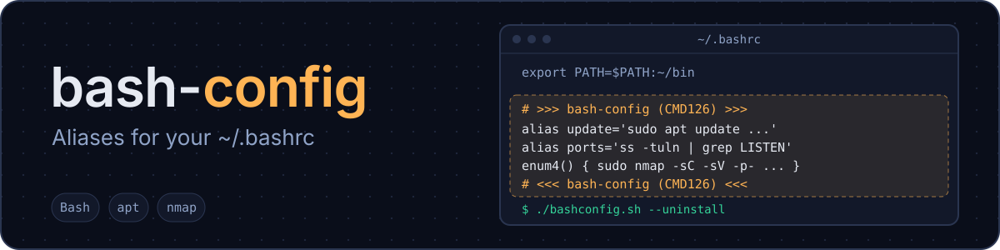

<p align="center"></p>

# bash-config

**One script that adds a block of maintenance, network and scanning aliases (plus an `enum4` function) to your `~/.bashrc`, and removes it again with `--uninstall`.**

It targets Kali Linux, Ubuntu and other Debian-based systems that use `apt`.

- [Principles](#principles)
- [Install and run](#install-and-run)
- [Using it](#using-it)
- [What it changes](#what-it-changes)
- [Limits of this version](#limits-of-this-version)
- [Tests](#tests)
- [License](#license)

## Principles

- Everything the installer writes sits between two marker lines. Nothing outside them is touched.
- A timestamped backup of `~/.bashrc` is made before every install and uninstall. Only the 3 newest backups are kept.
- It refuses to remove a block whose markers are missing, duplicated or out of order, and leaves the file unchanged.
- Running it again replaces the block instead of adding a second one.
- The scanning aliases are for systems you are authorised to test.

## Install and run

Requirements: Bash, `sudo` and `apt`. Optional tools used by some aliases: `nmap`, `htop`, `neofetch`, `flameshot`, `curl`, `ss`.

```bash
sudo apt install nmap htop neofetch flameshot curl net-tools   # optional tools
chmod +x bashconfig.sh
./bashconfig.sh
source ~/.bashrc
```

Other ways to start it:

```bash
bash /path/to/bashconfig.sh
bash -c "$(curl -fsSL https://raw.githubusercontent.com/CMD126/bash-config/main/bashconfig.sh)"
```

Read the script before you pipe anything from the network into a shell.

To remove it:

```bash
./bashconfig.sh --uninstall
source ~/.bashrc
```

## Using it

System maintenance:

| Alias | Runs |
| --- | --- |
| `update` | `sudo apt update && sudo apt full-upgrade -y` |
| `ifix` | `sudo apt install -f` |
| `fix` | `sudo apt --fix-broken install` |
| `clean` | `sudo apt autoclean && sudo apt autoremove -y && sudo apt clean` |
| `maint` | `update && clean` |

Network:

| Alias | Runs |
| --- | --- |
| `ports` | `ss -tuln \| grep LISTEN` |
| `portsfull` | `sudo ss -tulnp` |
| `conns` | `ss -tunap \| grep ESTAB` |
| `ufwstat` | `sudo ufw status verbose` |
| `myip` | `curl -s ifconfig.me` |

Scanning (only against systems you are authorised to test):

| Alias | Runs |
| --- | --- |
| `scan` | `sudo nmap -sS localhost -T4` |
| `nmap-quick` | `sudo nmap -F -T4` (give it a target) |

Utilities: `cls` (`clear`), `ll` (`ls -lah --color=auto`), `h` (`htop`), `nf` (`neofetch`), `shot` (`flameshot gui`).

The `enum4` function runs a full TCP port scan with default scripts and version detection (`sudo nmap -sC -sV -p-`) and writes the result to a file:

```bash
enum4 <target> [output_file]
enum4 127.0.0.1             # target defaults to localhost; file is enum4_127.0.0.1_<date-time>.txt
enum4 192.168.1.1 scan.txt  # custom output file
```

## What it changes

- It appends one block to `~/.bashrc` (or to the file named in the `BASHRC` environment variable, which is handy for a dry run on a copy).
- The block starts with `# >>> bash-config (CMD126) >>>` and ends with `# <<< bash-config (CMD126) <<<`.
- Before every install or uninstall it copies the file to `~/.bashrc.bak.<YYYYMMDD-HHMMSS>`. Only the 3 newest such backups are kept (`MAX_BACKUPS` at the top of the script); older ones are deleted. Other files are never touched.
- On install it first removes any existing block, including the older format that had no end marker, then writes the new one.
- Removal only happens when the start and end markers each appear exactly once, start first. Otherwise it prints an error to stderr, exits non-zero and changes nothing (no backup either). Fix the markers by hand and run it again.
- It installs nothing else and does not change any other file.

## Limits of this version

- `apt` only. Other package managers are not supported.
- The aliases run `sudo` and some need a password each time.
- Several aliases shadow common names (`fix`, `clean`, `update`, `h`, `ll`). Check they do not clash with your own.
- The tests cover the main install, reinstall, uninstall and backup cases only.

## Tests

```bash
bash tests/test_bashconfig.sh
```

The tests run against a temporary file through the `BASHRC` variable, so your real `~/.bashrc` is not touched. CI runs the same script plus `shellcheck`.

## License

MIT. See [LICENSE](LICENSE).
